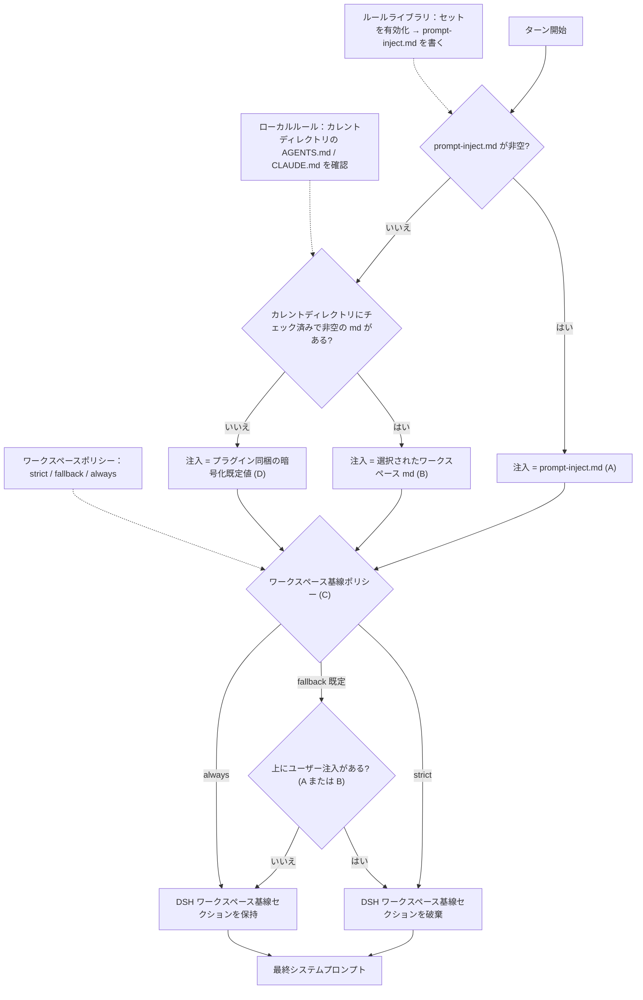
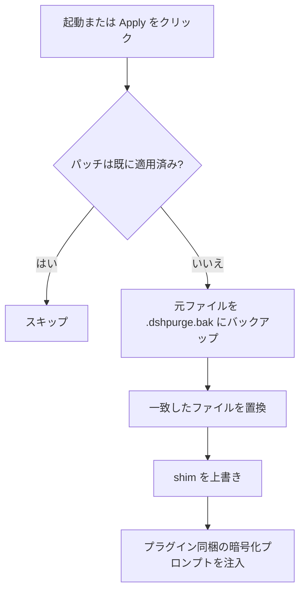

> **本リポジトリは [HunYiSage/dsh-purge](https://github.com/HunYiSage/dsh-purge) 1.1.90 の無制限フォークです。**
> ローカルターゲットゲート（`lib/net-scope.js`）とそのフック登録（`lib/index.js`）を撤去し、
> `skills/redteam/` を同梱、バックアップ管理パネルを追加しました。それ以外は上流のコードそのまま、
> Apache-2.0、`NOTICE` 保持。変更点の全体は [FORK-NOTICE.md](./FORK-NOTICE.md) を参照。
> 以下の「ローカルラボ限定」「チート禁止」といった記述は**上流の方針**であり、
> 本ビルドにはそれを強制するコードは入っていません。

<p align="center">
  
</p>

<h1 align="center">⚔️ DeepSeek Harness レッドチームツール（dsh-purge 無制限版）</h1>

<p align="center"><strong>バージョン 1.1.92</strong></p>

<p align="center">
  <a href="https://github.com/yuan-dev39/dsh-purge-unrestricted/stargazers"></a>
  <a href="https://github.com/yuan-dev39/dsh-purge-unrestricted/blob/main/LICENSE"></a>
  <a href="https://www.deepseek.com/harness/"></a>
  <br>
  
  
</p>

<p align="center">
  <a href="README.md">English</a> | <a href="README.zh-CN.md">中文</a> | <a href="README.ja.md">日本語</a>
</p>

## 目次

- [これは何か](#これは何か)
- [このフォークでの変更点](#このフォークでの変更点)
- [必要なもの](#必要なもの)
- [クライアントのダウンロード](#クライアントのダウンロード)
- [プラグインのインストール](#プラグインのインストール)
- [確認](#確認)
- [使い方](#使い方)
- [バックアップ管理パネル](#バックアップ管理パネル)
- [復元とアンインストール](#復元とアンインストール)
- [ディレクトリ構成](#ディレクトリ構成)
- [パス検出](#パス検出)
- [トラブルシューティング](#トラブルシューティング)
- [ローカルチェック](#ローカルチェック)
- [帰属とライセンス](#帰属とライセンス)

---

## これは何か

**dsh-purge** は、お使いのマシンにすでにインストールされている[公式 DeepSeek Harness](https://www.deepseek.com/harness/) 向けのレッドチームプラグインです。**1.1.92** は **DSH 0.2.1-rc.2** を対象とします（0.2.0 でも動作）。**DSH 0.2.1-rc.3 以降の RC は非対応。** 公式 **Web**（`dsh web`）と公式**デスクトップ EXE** の両方に対応。インストールと Apply はホストごとに別々に行います。

Harness はプロンプトを転送するだけではありません。実行時にプロンプト、承認ゲート、サンドボックスポリシー、セッション移行を書き換えます。「モデルが答えるか」だけを見ると、ホスト層のブロックをモデルの拒否と誤認します。本プラグインはその 2 層を手元のインストール上で分離し、統制された評価と、どの既定ポリシーが厳しすぎるかの確認を可能にします。

| 得られるもの | 内容 |
|---|---|
| **dsh-purge ドック** | セッションタイトル横のボタンで右パネルを開く。Clean と Drill の 2 ページ |
| **Clean** | パッチ状態のグループ表示、Apply / Restore / Uninstall、プロンプトエディタ、複数ルールセット |
| **Drill** | 同梱。認可後にアセットとローカル環境を表示。レッドチーム技能ドキュメント 23 本を同梱 |
| **ホストポリシー** | 既定文言、権限ポリシー、ツール制限。公式の能力は維持し、別の人格は作らない |
| **バックアップ管理** | サイドバー下部のエントリ。本プラグインとホストが書いたすべてのバックアップを一覧し、個別・一括削除が可能 |
| **起動時** | 毎回チェックして再適用。npm が `node_modules` を上書きしても手で編集しなくてよい |

ドライブレターはハードコードしません。`$DSH_HOME` → dsh ランチャー隣の `.dsh` → `~/.dsh` の順に探します。Harness のソースツリーは書き換えません。実際にファイルを書くのは **dsh-purge** パネル **Clean** ページの **Apply** です。アイデンティティはプラグインに同梱された暗号化プロンプト、つまりプロンプト欄に既定で表示されるテキストです。ホストのプロンプトファイルは読みません。

---

## このフォークでの変更点

詳細は [FORK-NOTICE.md](./FORK-NOTICE.md) と [release-notes.md](./release-notes.md) を参照。

### プラグイン

| 箇所 | 変更 |
|---|---|
| `lib/net-scope.js` | リージョンゲートを無効化：`isAttackTask` / `isCheatTask` は常に `false`、`publicHostHit` / `taskTargetHit` は常に `null`、`ownServerNote` は空文字列、`installRegionGate()` は即 return |
| `lib/index.js` | `installRegionGate(ctx)` を呼ばない |
| `skills/redteam/` | 技能ドキュメント 23 本を同梱（active-scan、asset-correlation、browser-automation、chisel-tunnel、cn-proxy-pool、credential-attack、dir-bruteforce、fofa-recon ほか） |
| `lib/backups.js` | **新規。** 4 種類のバックアップ元を集計、TTL キャッシュ 10 秒 |
| `client.js` | **新規。** サイドバー下部「历史备份目录管理」エントリ、ダイアログは portal 経由でマウント |

### クライアント（dsh-next）

| 箇所 | 変更 |
|---|---|
| `lib/main.js` | `DesktopUpdateCoordinator.start()` / `check()` を短絡——`https://www.dshdesktop.cn/api/desktop/version` への通信を停止。「更新を確認」は「最新です」とだけ返し、新しいビルドが改変済みファイルを上書きしない |
| `lib/main.js` | パッチ #82：エクスプローラ起動時に `DSH_PROFILE` が無ければ `desktop` にフォールバック |
| 手動調整 4 点 | ホスト起動タイムアウト 60s → 300s、サイドバー既定 360px・最大 780 までドラッグ可、サイドバー余白 10/4px、`/dsh-session-delete` と右クリック削除を追加 |

### 1.1.92 の修正

- **削除したセッションがサイドバーに残り、再起動するまで消えない** —— `deleteSession()` はホストがデータを消した後に `clearMain()` しか呼んでおらず、メモリ上のセッション一覧には要約が残ったままだった。そのため行は「未分類」に表示され続けた。削除成功後に `this.sessions.handleSessionRemoved(sessionId)` を呼ぶようにした。これはホストが remove 変更を push する時と同じ経路（`recordMutation({ kind: "remove" })` → `summaries.filter(...)` → `markDirty()` → 再描画）で、クリック直後に行が消える。マーカー: `[fix:delete-session-refresh]`。
- **harness パッチパック同期** —— `harness/patch/…/dsh-client-ui-workspace/lib/client.js` に修正を反映（233,647 → 234,292 B）、`MANIFEST.txt` を再計算し、62 エントリが `patch/` とバイト単位で一致（62/62）。
- **既知の問題（サーバー側）** —— `platform.deepseek.com` のアカウント読み取りエンドポイントは AWS WAF の JS チャレンジの背後にあり（`202` + `x-amzn-waf-action: challenge`）、ホストの Node `fetch` では突破できない。サインイン自体は可能（`auth_init` / `auth_exchange` は空 body で `422` を返す）。ブロックされるのはサインイン後の身元・残高読み取りのみで、チャットには影響しない。詳細は[トラブルシューティング](#トラブルシューティング)。

### 1.1.91 の修正

- **一覧に出るのに削除できない** —— `allowedRoots` は `aiBase`、走査ルートは `hostScanRoot(aiBase)`。`app\lib` 配下のバックアップが隙間に落ちていた。許可ルートを走査ルートに揃えた。
- **バックアップ一種類が丸ごと不可視** —— 文字クラス `[.-]` は `. (46)` → `- (45)` の空レンジで、V8 では何にもマッチしない。ホストが書く `.bak-<Date.now()>` がすべて漏れていた。`[-.]` に修正し、profile グループは 5 件から 15 件に回復。
- **フッターが 50/50 分割** —— 両エントリが flex 行内で `width:100%` を宣言。`flex:1 1 0` + `min-width:0` に変更。
- **ダイアログの位置ずれ** —— `document.body` に portal。不透明背景にし、スクロールはリストのみ。
- **Esc 1 回で 2 層閉じる** —— `stopPropagation` + `preventDefault`、body のスクロールもロック。
- **`setState` on unmounted** —— `load()` / `doDelete()` にアンマウントガードとリクエスト連番。
- **`wide` フォールバック** —— 明示的な `wide === true` のみ受理。
- **性能** —— `listBackups` は 1 回 270 ms、フロントは 30 秒ポーリング。TTL キャッシュ 10 秒（コールド 382 ms、ヒット 0 ms）＋フロント 5 分ポーリングに変更。

---

## 必要なもの

- Windows 10 / 11 x64（同梱クライアントは win-x64 のみ。プラグイン自体はクロスプラットフォーム）
- 空きディスク約 6 GB（クライアント解凍後 約 1.5 GB、同梱の Python / Node / pnpm ランタイムを含む）
- 下記の**改変クライアント**、または公式 DSH NEXT `2.0.19-next` の既存インストール（パッチ適用を許容できること）

Node と pnpm は**クライアントに同梱**されています。別途インストールは不要です。

---

## クライアントのダウンロード

クライアントは**このリポジトリのツリーには含まれません**。Release アセットとして配布しています。

**[releases/tag/harness-2.0.19-next-unrestricted](https://github.com/yuan-dev39/dsh-purge-unrestricted/releases/tag/harness-2.0.19-next-unrestricted)**

| ファイル | サイズ | 用途 |
|---|---|---|
| `DSH-NEXT-2.0.19-next-unrestricted-win-x64.zip` | 416.9 MB (437,123,932 B) | **クライアント一式。** 公式 `2.0.19-next` を解凍済み、パッチ適用済み、自動更新オフ。解凍して実行するだけ |
| `harness-patch-2.0.19-next.zip` | 0.91 MB (950,103 B) | 旧パッチ集。`harness-patch-1.1.92.zip` に置き換え済み |

すでにパッチ適用済みの `2.0.19-next` を動かしている場合、一式を再取得する必要はありません。[v1.1.92 リリース](https://github.com/yuan-dev39/dsh-purge-unrestricted/releases/tag/v1.1.92) の `harness-patch-1.1.92.zip`（0.93 MB、62 ファイル）を使ってください。

```powershell
# 1. 固定の場所に置く。デスクトップやダウンロードは不可——ホストは
#    profile、プラグイン、セッションをこのパス配下に保持する
New-Item -ItemType Directory -Force -Path "D:\DSH NEXT"

# 2. 解凍
Expand-Archive -Path "$env:USERPROFILE\Downloads\DSH-NEXT-2.0.19-next-unrestricted-win-x64.zip" `
               -DestinationPath "D:\DSH NEXT" -Force

# 3. Mark-of-the-Web を除去し、SmartScreen のブロックを解く
Get-ChildItem "D:\DSH NEXT" -Recurse -File | Unblock-File
```

形態が正しいか確認——**解凍済み**であること、`app.asar` に詰まったままではいけません。

```powershell
Test-Path "D:\DSH NEXT\DSH NEXT.exe"                    # True
Test-Path "D:\DSH NEXT\resources\app\lib\main.js"     # True
Select-String -Path "D:\DSH NEXT\resources\app\lib\main.js" -Pattern "updates-off" | Select-Object -First 3
```

3 番目に必ず出力が出ること。出力が無ければ自動更新は**無効化されていません**。原版を動かしています。

**初回起動。** `DSH NEXT.exe` をダブルクリック。初回起動で `%USERPROFILE%\.dsh` を作成し、同梱の `resources\runtime` から Python 3.12.14 / Node 24.21.0 / pnpm 11.8.0 をインストールします。完全オフライン、1〜3 分。UI は `http://127.0.0.1:<ポート>` で開きます。

SmartScreen が 1 回ブロックします（本パッケージはコード署名なし。公式パッケージも同様）。「詳細情報 → 実行」をクリック。

### 既存インストールにパッチを当てる場合

```powershell
# DSH NEXT を完全終了させる。トレイアイコンも含む
Expand-Archive -Path "$env:USERPROFILE\Downloads\harness-patch-1.1.92.zip" -DestinationPath "$env:TEMP\hpatch" -Force
cd "$env:TEMP\hpatch\harness"

# まず dry run：計画を表示するだけで、ファイルには触れない
powershell -ExecutionPolicy Bypass -File .\install-modified.ps1 -DryRun

# 本実行
powershell -ExecutionPolicy Bypass -File .\install-modified.ps1 -InstallDir "D:\DSH NEXT"

# ロールバック
powershell -ExecutionPolicy Bypass -File .\install-modified.ps1 -Revert
```

スクリプトの流れ：`MANIFEST.txt` を読み 62 ファイルの揃いを検証 → インストール先を特定 → **exe パスが対象ディレクトリ内にあるプロセスだけ**を終了 → `app.asar` を `app.asar.orig` に改名 → `asar-read.mjs`（依存ゼロの Node）で解凍 → `patch\` を上書き → 各ファイルの sha256 を検証。

---

## プラグインのインストール

**プラグインマーケットは使わないでください。** dsh-plugin.org のワンクリック導入や設定のプラグインマーケットは `already queued: dsh-purge` で失敗し、コマンドを一切実行しません。npm レジストリにこの名前は無いので `pnpm add dsh-purge` も不可。

**`codeload.github.com` 形式の URL を厳守してください。** `github.com/.../archive` は 302 リダイレクトを返し、pnpm が `fetch failed` で落ちます。

### コマンド 1 行（desktop プロファイル）

```powershell
# 同梱の pnpm を探す
Get-ChildItem "D:\DSH NEXT\resources" -Recurse -Filter "pnpm.cmd" -ErrorAction SilentlyContinue |
  Select-Object -First 3 FullName
```

```powershell
# 実際に使う profile 内で実行——リポジトリのルートではない
cd "$env:USERPROFILE\.dsh\profiles\desktop"

& "<上で見つかったパス>" add https://codeload.github.com/yuan-dev39/dsh-purge-unrestricted/tar.gz/refs/heads/main
```

`dsh` が PATH にある場合の等価なコマンド：

```sh
dsh plugin --profile desktop add https://codeload.github.com/yuan-dev39/dsh-purge-unrestricted/tar.gz/refs/heads/main
```

`dsh web` の場合は `desktop` を `web` に読み替えてください。

**pnpm 11/12 は install スクリプトを飛ばします**（`ERR_PNPM_IGNORED_BUILDS`）。許可フラグを付けて再実行します：

```powershell
& "<pnpm.cmd>" add `
  --allow-build=dsh-purge `
  --allow-build=dsh-purge@https://codeload.github.com/yuan-dev39/dsh-purge-unrestricted/tar.gz/refs/heads/main `
  https://codeload.github.com/yuan-dev39/dsh-purge-unrestricted/tar.gz/refs/heads/main
```

`postinstall` が `dsh-purge` を `dsh.profile.bundles` に書き込み、profile の `cordis.patch.yml` に body の `insert` を 1 行追加します。この insert が無いとホストはプラグインを読み込まず、ボタンも現れません。

### clone またはローカル zip から

```powershell
git clone https://github.com/yuan-dev39/dsh-purge-unrestricted.git
cd "$env:USERPROFILE\.dsh\profiles\desktop"
& "<pnpm.cmd>" add C:\path\to\dsh-purge-unrestricted
```

オフライン環境：[v1.1.92 リリース](https://github.com/yuan-dev39/dsh-purge-unrestricted/releases/tag/v1.1.92) の `dsh-purge-unrestricted-1.1.92.zip` をダウンロードし、解凍したディレクトリを上記の方法で `add` します。

### 再起動と Apply

1. ホストを**完全終了**——デスクトップ版はトレイアイコンも、Web 版は `dsh web` を停止。
2. 再度開く。セッションタイトル横に **dsh-purge** が現れる。
3. **dsh-purge** → **Clean** → **Apply** をクリック。Apply 成功でホストが 1 回再起動します。

Web 側の操作は Web のみ、デスクトップ側はデスクトップのみに効きます。片方のホストからもう片方を Apply しないでください。

### 手動インストール

コマンドがすべて失敗した場合のみ。**実際に動かす profile だけ**を編集し、JSON を壊さず、`dsh-purge` を二重に書かないこと。

```yaml
# <profile>\cordis.patch.yml —— body insert を 1 行追加
- insert:
    - id: dsh-purge
      name: 'dsh-purge'
      config:
        enabled: true
        autoApplyOnStart: true
        autoUpdateOnStart: false
        autoRevertOnMissing: false
        verbose: false
        postPromptOrder: 5100
        postPrompt: ""
```

次にその profile へパッケージを入れます：

```powershell
cd "$env:USERPROFILE\.dsh\profiles\desktop"
& "<pnpm.cmd>" install
```

---

## 確認

```powershell
# 1. パッケージが存在する
Test-Path "$env:USERPROFILE\.dsh\profiles\desktop\node_modules\dsh-purge\package.json"

# 2. bundle として登録されている
(Get-Content "$env:USERPROFILE\.dsh\profiles\desktop\package.json" -Raw |
  ConvertFrom-Json).dsh.profile.bundles -contains "dsh-purge"

# 3. patch ファイルに insert がある
Select-String -Path "$env:USERPROFILE\.dsh\profiles\desktop\cordis.patch.yml" -Pattern "id: dsh-purge"
```

3 つすべてが真である必要があります。1 つでも外れたらプラグインは読み込まれません。

チャット欄で：

```
/purge status
```

`DSH_HOME` とパッチ一覧を出力します。未インストールのオプションパッケージ（liangshen）は skipped と表示され、Apply を妨げません。

---

## 使い方

```sh
dsh-purge --status
dsh-purge --apply
dsh-purge --revert
dsh-purge --uninstall
dsh-purge --edit

/purge status | apply | revert | uninstall | edit | help
/rules  list | use <id> | create <id> | delete <id> | reset | help
/rewind

# 別のプラグインがすでに /rewind（または /purge、/rules、/skills）を所有している
# 場合、その名前はスキップされるか /purge-rewind として再マウントされます。
# ほかのコマンド、ツール、/dsh-purge/* ルートは動作し続けます。

purge_status   purge_apply   purge_revert
```

Apply が成功するとホストが再起動し、パッチ済みのパッケージが読み込まれます。パッチタイトルの下に安定版とテスト版があり、テスト版は `beta` ブランチに追随します。**Switch to stable** は `main` を入れ、固定を解除します。旧安定版を選ぶとそのバージョンに固定され、**Update** で最新に戻ります。

入力欄の**1 回取り消し**と**前ラウンド取り消し**は現在の会話内に留まり、ブランチを開きません。送信した行は入力欄に戻り、その切断点以降に送信済みのメッセージと完了済みタスクは現在の会話から外れます。編集して**再送信**します。**1.1.61** 以降、取り消し境界は**現在のターン**に追随し、最初のユーザーメッセージではありません。`/rewind` も同じ挙動です。

### プロンプト注入の判定順

毎ターン、3 つの入力が最終システムプロンプトを決めます。点線はそれぞれが駆動する判定を示します：



Apply の流れ：



---

## バックアップ管理パネル

サイドバー下部の **历史备份目录管理** エントリ。Cordis プラグインエントリの後ろに並び、設定行と同じ幅・高さです。バッジにリアルタイムのバックアップ件数を表示します。

```
GET  /dsh-purge/backups            キャッシュ経由、TTL 10 秒
GET  /dsh-purge/backups?force=1    キャッシュを迂回
POST /dsh-purge/backups            {"op":"delete","ids":[...]}
```

バックアップの 4 分類：

| グループ | 場所 | 書き手 |
|---|---|---|
| `host` | `<app>\**\*.dshpurge.bak` | 本プラグイン（Apply 前） |
| `profile` | `$DSH_HOME\profiles\**\*.bak` と `*.bak-<タイムスタンプ>` | ホストの `sanitizeProfile()`、および過去の手動スナップショット |
| `shim` | `$DSH_HOME\dsh-purge\shim-backups\` | shim の元ファイル |
| `snapshot` | `<プラグインルート>\lib.bak-restrict-*` | ディレクトリ丸ごとのスナップショット |

「インストールルートからの相対ディレクトリ」でグループ化し、先頭 3 グループを既定で展開、ヘッダーに総件数と総容量を表示。個別削除も全選択も確認ダイアログを経ます。削除するとキャッシュは即座に無効化されます。

安全弁：既知のルート配下にある `.bak` / `.bak-<タイムスタンプ>` のみ削除可能。`C:\Windows\System32\drivers\etc\hosts`、`.bak` 以外のファイル、パストラバーサル、使用中のプラグインファイルはすべて拒否します。

---

## 復元とアンインストール

- 最初の Apply 前に、各対象ファイルは `<file>.dshpurge.bak` へ複製されます。
- **Restore** または `/purge revert` はバックアップを書き戻し、バックアップを削除します。バックアップが無い場合は本プラグインが書いた shim 行を取り除きます。
- `prompt-inject.md` はユーザーファイルなので保持されます。
- **Uninstall** はパッチ適用済みならまず復元し、その後で注入ファイル、ルールライブラリ、プラグイン本体を削除します。
- Apply は冪等です。

---

## ディレクトリ構成

```
bin/                CLI エントリ
lib/                パッチ、ホスト検出、Drill コンソール、バックアップ集計
  backups.js        バックアップの走査 / 一覧 / 削除、TTL キャッシュ 10 秒
client.js          ドック：パッチパネル、プロンプトエディタ、ルールセット、バックアップ管理
presets/redteam/    レッドチームプリセット
skills/redteam/     技能ドキュメント 23 本
harness/            dsh-next パッチ集 + install-modified.ps1 + MANIFEST.txt
docs/               バナーとプレビュー画像
```

ランタイムファイルは `$DSH_HOME` 配下：`prompt-inject.md`、`rules/`、`redteam/`。`DSH_HOME` が未設定なら、ランチャー隣の `.dsh` が `~/.dsh` より優先されます。Web とデスクトップはそれぞれ別の home を使います。

---

## パス検出

まずホスト形態を判定します：`web` / `desktop`（`gui` / `tui` は予約名で、web にフォールバック）。

**Web：**
1. `DSH_HOME` / `DSH_BASE`
2. dsh ランチャー隣の `.dsh`（ポータブルインストール、任意のドライブ）
3. `npm prefix -g` / `npm root -g`
4. ネストした `@deepseek-ai/dsh/node_modules/@deepseek-ai`
5. `~/.dsh`

**公式デスクトップ EXE：** 実行中の Harness インストール（`resources/app` または解凍済みパッケージ）。ドライブレターはハードコードしません。Apply 成功で 1 回再起動します。

何も見つからない場合、`DSH_BASE` / `DSH_DESKTOP_INSTALL` を設定してください。ファイルは一切変更しません。

---

## トラブルシューティング

**セッションタイトル横にボタンが無い。** `dsh --dump-config` を実行し、body 行 `id: dsh-purge` を探します。無ければ bundle を補ってから完全終了して再起動：

```powershell
cd "$env:USERPROFILE\.dsh\profiles\desktop"
& "<同梱の node.exe>" node_modules\dsh-purge\scripts\ensure-profile-bundle.mjs
```

**マーケットが `already queued: dsh-purge` を返す。** マーケットをクリックするのをやめ、削除して入れ直します：

```sh
dsh plugin --profile desktop remove dsh-purge
dsh plugin --profile desktop add https://codeload.github.com/yuan-dev39/dsh-purge-unrestricted/tar.gz/refs/heads/main
```

**`cannot determine the boot profile`。** 原版クライアントをエクスプローラから起動しています。`lib/main.js` のパッチ #82 は環境変数が無いとき `DSH_PROFILE=desktop` を補います。`harness-patch-1.1.92.zip` を再適用するか、自分で設定してください：

```powershell
[Environment]::SetEnvironmentVariable("DSH_PROFILE", "desktop", "User")
```

**Apply が一部ファイルを skipped と報告する。** クライアント更新後に元ファイルが一致しなくなっています。それらは変更されず、Apply 自体は完了します。

**アカウントパネルが空で、ログに `account read failed` / `status: 403` が出る。** これはサーバー側の問題で、インストール不良ではありません。`platform.deepseek.com` はアカウント読み取りエンドポイント（`/auth-api/v0/users/current`、`/api/v0/users/get_unnotified_bonuses`）を AWS WAF の JS チャレンジの背後に置いており、応答は `202` と `x-amzn-waf-action: challenge` です。Node の `fetch` では突破できません。サインイン自体は正常です（`POST /auth-api/v0/dsh/auth_init` と `auth_exchange` は空 body で `422` = 応答あり）。チャットには影響しません（モデルは `api.deepseek.com` + API キー経由）。「トークンを送って 403 なら期限切れ」と判断して grant を消す"修正"はしないでください —— 有効なログイン状態を消してしまいます。

**プラグインは入ったが何も変わらない。** 別のホストに Apply しています。Web とデスクトップは別々の home です。`/purge status` が出力する `DSH_HOME` を確認してください。

---

## ローカルチェック

```sh
node --check lib/index.js
node --check lib/core.js
node --check lib/backups.js
node --check lib/net-scope.js
node --check lib/surface.js
node --check lib/web.js
node --check lib/desktop.js
node --check lib/host.js
node --check lib/rewind.js
node --check lib/skills.js
node --check client.js
```

---

## 帰属とライセンス

本リポジトリは [HunYiSage/dsh-purge](https://github.com/HunYiSage/dsh-purge) のフォークで、Apache-2.0 です。フォークと再配布では著作権表示と [NOTICE](./NOTICE) を保持し、元リポジトリを明記する必要があります。差分の詳細は [FORK-NOTICE.md](./FORK-NOTICE.md) を参照してください。

上流の「オリジナルビルドの転売禁止」条項は上流ビルドに適用されるもので、本フォーク自身の変更には及びません。本フォークの変更は同じ Apache-2.0 条件で公開します。

DSH NEXT 自体の権利は DeepSeek に帰属します。本リポジトリが配布するのは**インストール済み本体のパッケージスナップショット + ローカル改変**であり、公式インストーラではありません。
