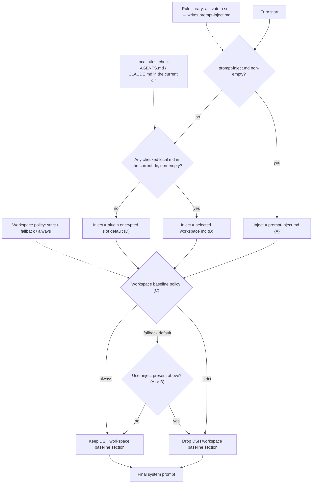
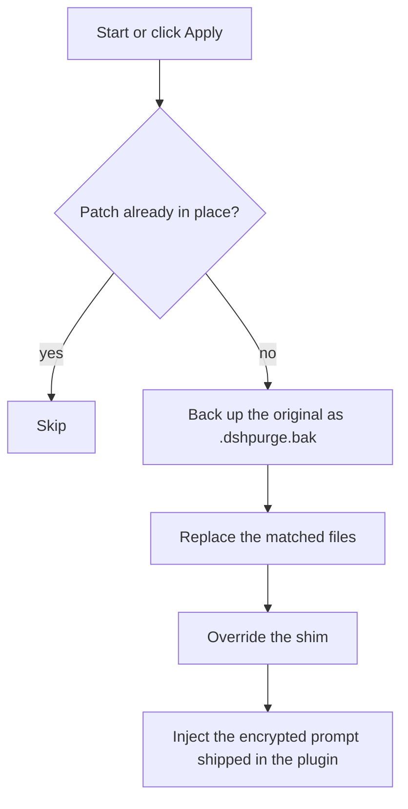

> **This is an unrestricted fork of [HunYiSage/dsh-purge](https://github.com/HunYiSage/dsh-purge) 1.1.90.**
> The local-target gate (`lib/net-scope.js`) and its hook installation (`lib/index.js`) are removed, a
> `skills/redteam/` library is bundled, and a backup manager is added. Everything else is upstream code,
> Apache-2.0, `NOTICE` retained. Full change list: [FORK-NOTICE.md](./FORK-NOTICE.md).
> Statements below about "local lab only" / "game cheats forbidden" describe **upstream policy**; the code
> enforcing them is not present in this build.

<p align="center">
  
</p>

<h1 align="center">⚔️ DeepSeek Harness cybersecurity red-team tool (dsh-purge, unrestricted)</h1>

<p align="center"><strong>Version 1.1.92</strong></p>

<p align="center">
  <em>DeepSeek Harness jailbreak: every model, swap prompts per model. Modified DSH NEXT client with auto-update disabled.</em>
</p>

<p align="center">
  <a href="https://github.com/yuan-dev39/dsh-purge-unrestricted/stargazers"></a>
  <a href="https://github.com/yuan-dev39/dsh-purge-unrestricted/blob/main/LICENSE"></a>
  <a href="https://www.deepseek.com/harness/"></a>
  <br>
  
  
  
</p>

<p align="center">
  <a href="README.md">English</a> | <a href="README.zh-CN.md">中文</a> | <a href="README.ja.md">日本語</a>
</p>

## Contents

- [What this is](#what-this-is)
- [What changed in this fork](#what-changed-in-this-fork)
- [What you need](#what-you-need)
- [Download the client](#download-the-client)
- [Install the plugin](#install-the-plugin)
- [Verify](#verify)
- [Use](#use)
- [The backup manager](#the-backup-manager)
- [Restore and uninstall](#restore-and-uninstall)
- [Layout](#layout)
- [Path detection](#path-detection)
- [Troubleshooting](#troubleshooting)
- [Local checks](#local-checks)
- [Attribution and license](#attribution-and-license)

---

## What this is

**dsh-purge** is a cybersecurity red-team plugin for the official [DeepSeek Harness](https://www.deepseek.com/harness/) already installed on your machine. **1.1.92** targets **DSH 0.2.1-rc.2** (0.2.0 still works). **DSH 0.2.1-rc.3 and newer RCs are not supported.** Official **Web** (`dsh web`) and the official **desktop EXE** are both supported. Install and Apply them separately.

Harness does more than forward a prompt. It rewrites prompts, approval gates, sandbox policy, and session migration at runtime. Asking only "will the model answer" treats a host-layer block as a model refusal. This plugin separates those two layers on your own install, for controlled evaluation and for seeing which default policy is too tight.

| You get | What it does |
|---|---|
| **dsh-purge dock** | A button beside the session title opens the right dock. Two pages: Clean and Drill |
| **Clean** | Grouped patch status, Apply / Restore / Uninstall, prompt editor, multiple rule sets |
| **Drill** | Built into the release. After authorization: assets and the local environment. 23 red-team skill docs bundled |
| **Host policy** | Default copy, permission policy, and tool limits. Official capabilities stay. No second invented identity |
| **Backup manager** | Sidebar entry listing every backup this plugin and the host ever wrote, with per-file and bulk delete |
| **On start** | Checks and reapplies. After npm overwrites `node_modules`, you do not hand-edit files |

No hardcoded drive letters. It looks at `$DSH_HOME`, `.dsh` next to the dsh launcher, then `~/.dsh`. It does not patch the Harness source tree. **Apply** on the **Clean** page of **dsh-purge** is what writes the changes. Identity comes from the encrypted prompt shipped in the plugin, the text the prompt box shows by default. The host prompt file is not read.

---

## What changed in this fork

Full detail: [FORK-NOTICE.md](./FORK-NOTICE.md) and [release-notes.md](./release-notes.md).

### Plugin

| Area | Change |
|---|---|
| `lib/net-scope.js` | Region gate neutralized: `isAttackTask` / `isCheatTask` return `false`, `publicHostHit` / `taskTargetHit` return `null`, `ownServerNote` returns an empty string, `installRegionGate()` returns immediately |
| `lib/index.js` | `installRegionGate(ctx)` is no longer called |
| `skills/redteam/` | 23 skill docs bundled (active-scan, asset-correlation, browser-automation, chisel-tunnel, cn-proxy-pool, credential-attack, dir-bruteforce, fofa-recon, …) |
| `lib/backups.js` | **New.** Backup inventory over four sources with a 10-second TTL cache |
| `client.js` | **New.** Sidebar footer entry "历史备份目录管理" (backup manager) with a portalled dialog |

### Client (dsh-next)

| Area | Change |
|---|---|
| `lib/main.js` | `DesktopUpdateCoordinator.start()` / `check()` short-circuited — no request to `https://www.dshdesktop.cn/api/desktop/version`, "check for updates" reports "already current", a new build never overwrites your patched files |
| `lib/main.js` | Patch #82: `DSH_PROFILE` falls back to `desktop` when the Explorer-launched environment lacks it |
| 4 manual tweaks | Host start timeout 60s → 300s; sidebar default 360px / draggable to 780; sidebar padding 10/4px; `/dsh-session-delete` + right-click delete |

### 1.1.92 fixes

- **Deleted sessions stayed in the sidebar until a restart** — `deleteSession()` only ran `clearMain()` after the Host removed the data, so the in-memory session list kept the summary and the row remained under Ungrouped. The client now calls `this.sessions.handleSessionRemoved(sessionId)` after a successful delete, which is the same path a Host-pushed removal takes (`recordMutation({ kind: "remove" })` → `summaries.filter(...)` → `markDirty()` → re-render). The row is gone immediately. Marker: `[fix:delete-session-refresh]`.
- **Harness pack synced** — `harness/patch/…/dsh-client-ui-workspace/lib/client.js` carries the fix (233,647 → 234,292 B) and `MANIFEST.txt` was regenerated (62/62 byte-for-byte).
- **Known issue, server side** — the account-read endpoints on `platform.deepseek.com` are behind an AWS WAF JS challenge (`202` + `x-amzn-waf-action: challenge`), which the Host's Node `fetch` cannot satisfy. Sign-in still works (`auth_init` / `auth_exchange` answer `422` on an empty body); only the identity/balance read fails, and chat is unaffected. Details in [Troubleshooting](#troubleshooting).

### 1.1.91 fixes

- **Listed but not deletable** — `allowedRoots` used `aiBase` while the scan root is `hostScanRoot(aiBase)`; backups in `app\lib` sat in the gap. Roots are now aligned with the scan root.
- **A whole backup class invisible** — the character class `[.-]` is the empty range `. (46)` → `- (45)` and matches nothing in V8, so the host's `.bak-<Date.now()>` files never showed. Changed to `[-.]`; the profile group went from 5 entries to 15.
- **Footer split 50/50** — both entries declared `width:100%` inside a flex row. Now `flex:1 1 0` + `min-width:0`.
- **Dialog misplacement** — portalled to `document.body`; opaque background, only the list scrolls.
- **One Escape closed two layers** — `stopPropagation` + `preventDefault`, plus body scroll lock.
- **`setState` on unmounted** — unmount guard and request sequence in `load()` / `doDelete()`.
- **`wide` fallback** — only an explicit `wide === true` is honoured now.
- **Performance** — `listBackups` 270 ms per call on a 30 s poll → 10 s TTL cache (382 ms cold, 0 ms on hit) and 5-minute client polling.

---

## What you need

- Windows 10 / 11 x64 (the bundled client is win-x64 only; the plugin itself is cross-platform)
- About 6 GB free disk (client unpacks to roughly 1.5 GB, plus the bundled Python / Node / pnpm runtime)
- Either the **modified DSH NEXT client** below, or an existing official DSH NEXT `2.0.19-next` install you are willing to patch

Node and pnpm come **with** the client. You do not need to install them.

---

## Download the client

The client is **not** in this repository's file tree. It ships as a Release asset:

**[releases/tag/harness-2.0.19-next-unrestricted](https://github.com/yuan-dev39/dsh-purge-unrestricted/releases/tag/harness-2.0.19-next-unrestricted)**

| File | Size | Use |
|---|---|---|
| `DSH-NEXT-2.0.19-next-unrestricted-win-x64.zip` | 416.9 MB (437,123,932 B) | **Full client.** Official `2.0.19-next` already unpacked, patches in place, auto-update disabled. Unzip and run |
| `harness-patch-2.0.19-next.zip` | 0.91 MB (950,103 B) | Old patch set. Superseded by `harness-patch-1.1.92.zip` |

If you already run a patched `2.0.19-next`, do not re-download the full client. Take `harness-patch-1.1.92.zip` from the [v1.1.92 release](https://github.com/yuan-dev39/dsh-purge-unrestricted/releases/tag/v1.1.92) instead (0.93 MB, 62 files).

```powershell
# 1. Fixed location. Not Desktop, not Downloads — the host keeps profile, plugins and
#    sessions under this path.
New-Item -ItemType Directory -Force -Path "D:\DSH NEXT"

# 2. Unzip
Expand-Archive -Path "$env:USERPROFILE\Downloads\DSH-NEXT-2.0.19-next-unrestricted-win-x64.zip" `
               -DestinationPath "D:\DSH NEXT" -Force

# 3. Strip Mark-of-the-Web so SmartScreen stops blocking
Get-ChildItem "D:\DSH NEXT" -Recurse -File | Unblock-File
```

Confirm the shape is right — the app must be **unpacked**, not packed in `app.asar`:

```powershell
Test-Path "D:\DSH NEXT\DSH NEXT.exe"                    # True
Test-Path "D:\DSH NEXT\resources\app\lib\main.js"     # True
Select-String -Path "D:\DSH NEXT\resources\app\lib\main.js" -Pattern "updates-off" | Select-Object -First 3
```

The third command must print matches. No output means auto-update is **not** disabled and you are running a stock install.

**First launch.** Double-click `DSH NEXT.exe`. The first start creates `%USERPROFILE%\.dsh` and installs Python 3.12.14 / Node 24.21.0 / pnpm 11.8.0 from the bundled `resources\runtime` — fully offline, 1–3 minutes. The UI opens at `http://127.0.0.1:<port>`.

SmartScreen blocks once (the package is not code-signed — neither is the official one). Click **More info → Run anyway**.

### Patching an existing install instead

```powershell
# Quit DSH NEXT completely, INCLUDING the tray icon
Expand-Archive -Path "$env:USERPROFILE\Downloads\harness-patch-1.1.92.zip" -DestinationPath "$env:TEMP\hpatch" -Force
cd "$env:TEMP\hpatch\harness"

# Dry run first — prints the plan, touches nothing
powershell -ExecutionPolicy Bypass -File .\install-modified.ps1 -DryRun

# Real run
powershell -ExecutionPolicy Bypass -File .\install-modified.ps1 -InstallDir "D:\DSH NEXT"

# Roll back
powershell -ExecutionPolicy Bypass -File .\install-modified.ps1 -Revert
```

The script reads `MANIFEST.txt`, verifies all 62 files, kills **only** processes whose exe path lies inside the target directory, renames `app.asar` to `app.asar.orig`, unpacks it with `asar-read.mjs` (zero-dependency Node), overlays `patch\`, and checks each file's sha256.

---

## Install the plugin

**Do not use the plugin marketplace.** One-click install on dsh-plugin.org or in Settings → Plugin Market fails with `already queued: dsh-purge` and never runs a command. The name is not on the npm registry, so do not `pnpm add dsh-purge`.

**Use the `codeload.github.com` URL exactly.** `github.com/.../archive` returns a 302 and pnpm fails with `fetch failed`.

### One command (desktop profile)

```powershell
# Locate the bundled pnpm
Get-ChildItem "D:\DSH NEXT\resources" -Recurse -Filter "pnpm.cmd" -ErrorAction SilentlyContinue |
  Select-Object -First 3 FullName
```

```powershell
# Run inside the profile you actually use — NOT the repo root
cd "$env:USERPROFILE\.dsh\profiles\desktop"

& "<path from above>" add https://codeload.github.com/yuan-dev39/dsh-purge-unrestricted/tar.gz/refs/heads/main
```

With `dsh` on PATH the same thing is:

```sh
dsh plugin --profile desktop add https://codeload.github.com/yuan-dev39/dsh-purge-unrestricted/tar.gz/refs/heads/main
```

Swap `desktop` for `web` on `dsh web`.

**pnpm 11/12 skips install scripts** (`ERR_PNPM_IGNORED_BUILDS`). Pass the allow flag and rerun:

```powershell
& "<pnpm.cmd>" add `
  --allow-build=dsh-purge `
  --allow-build=dsh-purge@https://codeload.github.com/yuan-dev39/dsh-purge-unrestricted/tar.gz/refs/heads/main `
  https://codeload.github.com/yuan-dev39/dsh-purge-unrestricted/tar.gz/refs/heads/main
```

`postinstall` writes `dsh-purge` into `dsh.profile.bundles` and adds a body `insert` in the profile `cordis.patch.yml`. Without that insert the host never loads the plugin and no button appears.

### From a clone or a local zip

```powershell
git clone https://github.com/yuan-dev39/dsh-purge-unrestricted.git
cd "$env:USERPROFILE\.dsh\profiles\desktop"
& "<pnpm.cmd>" add C:\path\to\dsh-purge-unrestricted
```

Offline machines: download `dsh-purge-unrestricted-1.1.92.zip` from the [v1.1.92 release](https://github.com/yuan-dev39/dsh-purge-unrestricted/releases/tag/v1.1.92), unzip it, then `add` the unzipped directory as above.

### Restart and Apply

1. **Fully quit** the host — Desktop: quit the tray icon too; Web: stop `dsh web`.
2. Reopen it. **dsh-purge** appears beside the session title.
3. Click **dsh-purge** → **Clean** → **Apply**. A successful Apply restarts the host once.

Web controls affect Web only; desktop controls affect the desktop app only. Do not Apply one host from the other.

### Manual install

Use this only when the commands fail. Edit **only the profile for the host you run**, keep the JSON valid, and do not list `dsh-purge` twice.

```yaml
# <profile>\cordis.patch.yml — add a body insert
- insert:
    - id: dsh-purge
      name: 'dsh-purge'
      config:
        enabled: true
        autoApplyOnStart: true
        autoUpdateOnStart: false
        autoRevertOnMissing: false
        verbose: false
        postPromptOrder: 5100
        postPrompt: ""
```

Then add the package to that profile:

```powershell
cd "$env:USERPROFILE\.dsh\profiles\desktop"
& "<pnpm.cmd>" install
```

---

## Verify

```powershell
# 1. Package landed
Test-Path "$env:USERPROFILE\.dsh\profiles\desktop\node_modules\dsh-purge\package.json"

# 2. Registered as a bundle
(Get-Content "$env:USERPROFILE\.dsh\profiles\desktop\package.json" -Raw |
  ConvertFrom-Json).dsh.profile.bundles -contains "dsh-purge"

# 3. Insert present in the patch file
Select-String -Path "$env:USERPROFILE\.dsh\profiles\desktop\cordis.patch.yml" -Pattern "id: dsh-purge"
```

All three must be true. Any miss means the plugin will not load.

In chat:

```
/purge status
```

It prints `DSH_HOME` and the patch list. Optional packages that are not installed (liangshen) show as skipped and do not block Apply.

---

## Use

```sh
dsh-purge --status
dsh-purge --apply
dsh-purge --revert
dsh-purge --uninstall
dsh-purge --edit

/purge status | apply | revert | uninstall | edit | help
/rules  list | use <id> | create <id> | delete <id> | reset | help
/rewind

# If another plugin already owns /rewind (or /purge, /rules, /skills), that name
# is skipped or remounted as /purge-rewind. Other commands, tools, and
# /dsh-purge/* routes keep working.

purge_status   purge_apply   purge_revert
```

After a successful Apply the host restarts so patched packages load. Under the patch title sit the stable release and the test release; the test release follows the `beta` branch. **Switch to stable** installs `main` and clears any pin. Picking an older stable version pins it; click **Update** to return to the latest.

The composer **Undo once** and **Undo last round** stay in the current conversation and do not open a branch. The sent line goes back into the input, and that cut's already-sent messages and completed tasks leave the current conversation; edit and **send again**. From **1.1.61**, rewind bounds follow the **current turn**, not the first user message. `/rewind` does the same.

### Prompt injection decision

At every turn, three inputs decide the final system prompt. The dotted edges below show which decision each one drives:



Apply flow:



---

## The backup manager

Sidebar footer entry **历史备份目录管理**, ordered after the Cordis plugin entry, same width and height as the settings row. The badge shows the live backup count.

```
GET  /dsh-purge/backups            cached, 10 s TTL
GET  /dsh-purge/backups?force=1    bypass the cache
POST /dsh-purge/backups            {"op":"delete","ids":[...]}
```

Four backup classes:

| Group | Location | What wrote it |
|---|---|---|
| `host` | `<app>\**\*.dshpurge.bak` | This plugin, before each Apply |
| `profile` | `$DSH_HOME\profiles\**\*.bak` and `*.bak-<timestamp>` | The host's `sanitizeProfile()`, plus legacy manual snapshots |
| `shim` | `$DSH_HOME\dsh-purge\shim-backups\` | Shim originals |
| `snapshot` | `<plugin root>\lib.bak-restrict-*` | Whole-directory snapshots |

Grouped by directory relative to the install root, first three groups expanded, total count and size in the header. Single delete and select-all both go through a confirmation step. Deleting invalidates the cache immediately.

Safety guards: only `.bak` / `.bak-<timestamp>` names under known roots are deletable. `C:\Windows\System32\drivers\etc\hosts`, any non-`.bak` file, path traversal, and live plugin files are rejected.

---

## Restore and uninstall

- Each target is copied to `<file>.dshpurge.bak` before the first apply.
- **Restore** or `/purge revert` copies backups back and deletes them. With no backup, shim lines written by this plugin are stripped.
- `prompt-inject.md` is a user file and is kept.
- **Uninstall** restores first if patches were applied, then deletes the inject file, rule library, and the plugin itself.
- Apply is idempotent.

---

## Layout

```
bin/                CLI entry
lib/                patches, host detection, drill console, backup inventory
  backups.js        backup scan / list / delete, 10 s TTL cache
client.js           the dock: patches UI, prompt editor, rule sets, backup manager
presets/redteam/    red-team preset
skills/redteam/     23 skill docs
harness/            dsh-next patch set + install-modified.ps1 + MANIFEST.txt
docs/               banner, preview screenshots
```

Runtime files live under `$DSH_HOME`: `prompt-inject.md`, `rules/`, `redteam/`. If `DSH_HOME` is unset, the launcher-adjacent `.dsh` wins over `~/.dsh`. Web and the desktop app each use their own home.

---

## Path detection

The host surface is detected first: `web` / `desktop` (`gui` / `tui` are reserved and still fall back to web).

**Web:**
1. `DSH_HOME` / `DSH_BASE`
2. `.dsh` next to the dsh launcher (portable install, any drive)
3. `npm prefix -g` / `npm root -g`
4. Nested `@deepseek-ai/dsh/node_modules/@deepseek-ai`
5. `~/.dsh`

**Official desktop EXE:** the running Harness install (`resources/app` or the unpacked package). The drive letter is not hard-coded. A successful Apply restarts once.

If nothing is found, set `DSH_BASE` / `DSH_DESKTOP_INSTALL`. No files are changed.

---

## Troubleshooting

**No button beside the session title.** Run `dsh --dump-config` and look for a body row `id: dsh-purge`. Absent → rerun `ensure-profile-bundle.mjs` then fully quit and reopen:

```powershell
cd "$env:USERPROFILE\.dsh\profiles\desktop"
& "<bundled node.exe>" node_modules\dsh-purge\scripts\ensure-profile-bundle.mjs
```

**The market says `already queued: dsh-purge`.** Stop clicking the market. Remove and re-add:

```sh
dsh plugin --profile desktop remove dsh-purge
dsh plugin --profile desktop add https://codeload.github.com/yuan-dev39/dsh-purge-unrestricted/tar.gz/refs/heads/main
```

**`cannot determine the boot profile`.** You are on a stock client patched from Explorer. Patch #82 in `lib/main.js` sets `DSH_PROFILE=desktop` when the environment lacks it; re-apply `harness-patch-1.1.92.zip`, or set it yourself:

```powershell
[Environment]::SetEnvironmentVariable("DSH_PROFILE", "desktop", "User")
```

**Apply reports files as skipped.** After a client upgrade some originals no longer match. Those files stay untouched and Apply still completes.

**Account panel is empty and the log says `account read failed` / `status: 403`.** Server side, not your install. `platform.deepseek.com` puts its account-read endpoints (`/auth-api/v0/users/current`, `/api/v0/users/get_unnotified_bonuses`) behind an AWS WAF JS challenge — the response is `202` with `x-amzn-waf-action: challenge`, which a Node `fetch` can never satisfy. Sign-in itself is fine: `POST /auth-api/v0/dsh/auth_init` and `auth_exchange` return `422` on an empty body, i.e. they answer. Chat is unaffected (models come from `api.deepseek.com` with an API key). Do **not** "fix" this by treating a 403-with-token as an expired token — that clears a working login.

**Plugins install but nothing changes.** Applying to the wrong host. Web and desktop are separate homes; check which `DSH_HOME` `/purge status` prints.

---

## Local checks

```sh
node --check lib/index.js
node --check lib/core.js
node --check lib/backups.js
node --check lib/net-scope.js
node --check lib/surface.js
node --check lib/web.js
node --check lib/desktop.js
node --check lib/host.js
node --check lib/rewind.js
node --check lib/skills.js
node --check client.js
```

---

## Attribution and license

This repository is a fork of [HunYiSage/dsh-purge](https://github.com/HunYiSage/dsh-purge), Apache-2.0. Forks and redistributions must keep the copyright notice and [NOTICE](./NOTICE), and name the source repository. See [FORK-NOTICE.md](./FORK-NOTICE.md) for exactly what differs.

Upstream's *"resale of the original build is prohibited"* term applies to the upstream build; it does not extend to this fork's own modifications, which are released under the same Apache-2.0 terms.

DSH NEXT itself belongs to DeepSeek. What this repository distributes is a **packaged snapshot of an installed copy plus local modifications** — not an official installer.
