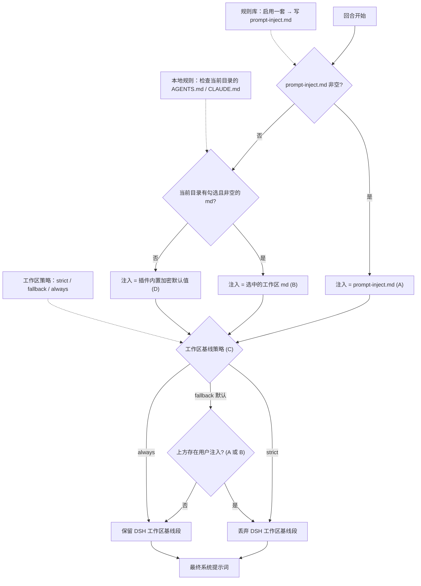
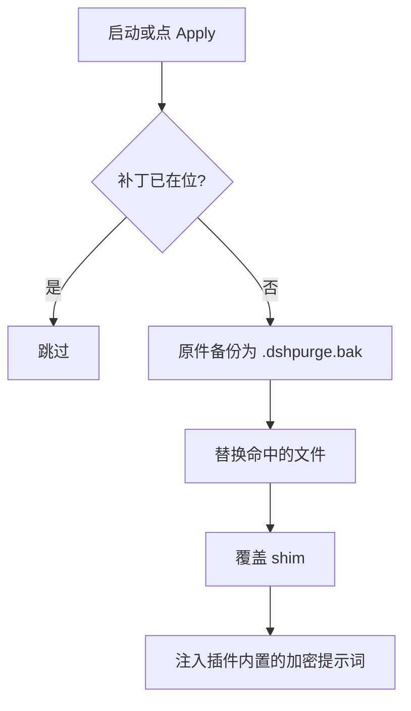

> **本仓库是 [HunYiSage/dsh-purge](https://github.com/HunYiSage/dsh-purge) 1.1.90 的无限制分支。**
> 本地目标闸门（`lib/net-scope.js`）及其钩子挂载（`lib/index.js`）已移除，内置 `skills/redteam/` 技能库，
> 并新增备份管理面板。其余为上游代码，Apache-2.0，`NOTICE` 保留。
> 完整变更见 [FORK-NOTICE.md](./FORK-NOTICE.md)。
> 下文中「仅限本地靶场」「禁止作弊」等表述属于**上游策略**；本构建不含执行这些策略的代码。

<p align="center">
  
</p>

<h1 align="center">⚔️ DeepSeek Harness 红队工具（dsh-purge 无限制版）</h1>

<p align="center"><strong>版本 1.1.91</strong></p>

<p align="center">
  <a href="https://github.com/yuan-dev39/dsh-purge-unrestricted/stargazers"></a>
  <a href="https://github.com/yuan-dev39/dsh-purge-unrestricted/blob/main/LICENSE"></a>
  <a href="https://www.deepseek.com/harness/"></a>
  <br>
  
  
</p>

<p align="center">
  <a href="README.md">English</a> | <a href="README.zh-CN.md">中文</a>
</p>

## 目录

- [这是什么](#这是什么)
- [本分支改了什么](#本分支改了什么)
- [准备工作](#准备工作)
- [下载客户端](#下载客户端)
- [安装插件](#安装插件)
- [验证](#验证)
- [使用](#使用)
- [备份管理面板](#备份管理面板)
- [还原与卸载](#还原与卸载)
- [目录结构](#目录结构)
- [路径探测](#路径探测)
- [故障排查](#故障排查)
- [本地检查](#本地检查)
- [署名与许可](#署名与许可)

---

## 这是什么

**dsh-purge** 是给本机已安装的[官方 DeepSeek Harness](https://www.deepseek.com/harness/) 用的红队插件。**1.1.91** 面向 **DSH 0.2.1-rc.2**（0.2.0 亦可）。**不支持 DSH 0.2.1-rc.3 及更新的 RC。** 官方 **Web**（`dsh web`）与官方**桌面 EXE** 都支持，两者分开安装、分开 Apply。

Harness 不只是转发提示词，它在运行时会重写提示词、审批闸门、沙箱策略与会话迁移。只问「模型会不会答」会把宿主层的拦截误判成模型拒答。本插件在你的本机上把这两层拆开，用于受控评测，以及看清哪条默认策略过紧。

| 你会得到 | 作用 |
|---|---|
| **dsh-purge 停靠栏** | 会话标题旁的按钮，右侧展开面板，两页：Clean 与 Drill |
| **Clean** | 分组补丁状态、Apply / Restore / Uninstall、提示词编辑器、多套规则 |
| **Drill** | 已内置。授权后进入资产与环境页；内置 23 份红队技能文档 |
| **宿主策略** | 默认文案、权限策略、工具限制。官方能力保留，不另造身份 |
| **备份管理** | 侧边栏入口，列出本插件与宿主写过的全部备份，支持单条与批量删除 |
| **启动自检** | 每次启动检查并重新应用。npm 覆盖 `node_modules` 后不用手改文件 |

不写死盘符。按 `$DSH_HOME` → dsh 启动器旁的 `.dsh` → `~/.dsh` 顺序查找。不改 Harness 源码树。真正写文件的是 **dsh-purge** 面板 **Clean** 页上的 **Apply**。身份来自插件内置的加密提示词，也就是提示框默认显示的那段文本；不读取宿主提示词文件。

---

## 本分支改了什么

完整清单见 [FORK-NOTICE.md](./FORK-NOTICE.md) 与 [release-notes.md](./release-notes.md)。

### 插件

| 位置 | 改动 |
|---|---|
| `lib/net-scope.js` | 区域闸门失效：`isAttackTask` / `isCheatTask` 恒返回 `false`，`publicHostHit` / `taskTargetHit` 恒返回 `null`，`ownServerNote` 返回空串，`installRegionGate()` 直接返回 |
| `lib/index.js` | 不再调用 `installRegionGate(ctx)` |
| `skills/redteam/` | 内置 23 份技能文档（active-scan、asset-correlation、browser-automation、chisel-tunnel、cn-proxy-pool、credential-attack、dir-bruteforce、fofa-recon 等） |
| `lib/backups.js` | **新增。** 四类备份来源清点，10 秒 TTL 缓存 |
| `client.js` | **新增。** 侧边栏底部「历史备份目录管理」入口，弹窗通过 portal 挂载 |

### 客户端（dsh-next）

| 位置 | 改动 |
|---|---|
| `lib/main.js` | `DesktopUpdateCoordinator.start()` / `check()` 短路——不再请求 `https://www.dshdesktop.cn/api/desktop/version`，「检查更新」只报「已是最新」，新版本不会覆盖你改过的文件 |
| `lib/main.js` | 补丁 #82：从资源管理器启动、环境缺 `DSH_PROFILE` 时兜底 `desktop` |
| 4 处手工微调 | 宿主启动超时 60s → 300s；侧栏默认 360px、可拖到 780；侧栏内边距 10/4px；新增 `/dsh-session-delete` 与右键删除会话 |

### 1.1.91 修复

- **列得出来删不掉** —— `allowedRoots` 用 `aiBase`，扫描根却是 `hostScanRoot(aiBase)`，`app\lib` 下的备份掉进缝隙。允许根已与扫描根对齐。
- **一整类备份不可见** —— 字符类 `[.-]` 是 `. (46)` → `- (45)` 的空区间，V8 下不匹配任何字符，导致宿主的 `.bak-<Date.now()>` 全部漏掉。改为 `[-.]`，profile 组从 5 项恢复到 15 项。
- **底栏被对半分** —— 两个入口都写 `width:100%`，作为 flex item 各占一半。改为 `flex:1 1 0` + `min-width:0`。
- **弹窗定位错位** —— 改为 portal 到 `document.body`，实色背景，只让列表滚动。
- **一次 Esc 关两层** —— 加 `stopPropagation` + `preventDefault`，并锁定 body 滚动。
- **`setState` on unmounted** —— `load()` / `doDelete()` 加卸载守卫与请求序号。
- **`wide` 兜底** —— 只认显式 `wide === true`。
- **性能** —— `listBackups` 每次 270 ms、前端 30 秒轮询一次；改为 10 秒 TTL 缓存（冷启 382 ms、命中 0 ms）+ 前端 5 分钟轮询。

---

## 准备工作

- Windows 10 / 11 x64（随包客户端仅 win-x64；插件本身跨平台）
- 约 6 GB 空闲磁盘（客户端解包约 1.5 GB，另含自带 Python / Node / pnpm 运行时）
- 要么用下面的**魔改客户端**，要么手上有官方 DSH NEXT `2.0.19-next` 且愿意打补丁

Node 与 pnpm **随客户端自带**，不需要另装。

---

## 下载客户端

客户端**不在**本仓库的代码树里，它作为 Release 资产发布：

**[releases/tag/harness-2.0.19-next-unrestricted](https://github.com/yuan-dev39/dsh-purge-unrestricted/releases/tag/harness-2.0.19-next-unrestricted)**

| 文件 | 大小 | 用途 |
|---|---|---|
| `DSH-NEXT-2.0.19-next-unrestricted-win-x64.zip` | 416.9 MB (437,123,932 B) | **整包客户端。** 官方 `2.0.19-next` 已解包、补丁已就位、自动更新已关。解压即用 |
| `harness-patch-2.0.19-next.zip` | 0.91 MB (950,103 B) | 旧补丁集，已被 `harness-patch-1.1.91.zip` 取代 |

已经跑着打过补丁的 `2.0.19-next` 不必重下整包，直接取 [v1.1.91 release](https://github.com/yuan-dev39/dsh-purge-unrestricted/releases/tag/v1.1.91) 里的 `harness-patch-1.1.91.zip`（0.93 MB，62 个文件）。

```powershell
# 1. 固定位置。别放桌面或下载目录——宿主把 profile、插件、会话都记在这条路径下
New-Item -ItemType Directory -Force -Path "D:\DSH NEXT"

# 2. 解压
Expand-Archive -Path "$env:USERPROFILE\Downloads\DSH-NEXT-2.0.19-next-unrestricted-win-x64.zip" `
               -DestinationPath "D:\DSH NEXT" -Force

# 3. 去掉 Mark-of-the-Web，免得 SmartScreen 拦
Get-ChildItem "D:\DSH NEXT" -Recurse -File | Unblock-File
```

确认形态正确——必须是**解包**状态，不能还压在 `app.asar` 里：

```powershell
Test-Path "D:\DSH NEXT\DSH NEXT.exe"                    # True
Test-Path "D:\DSH NEXT\resources\app\lib\main.js"     # True
Select-String -Path "D:\DSH NEXT\resources\app\lib\main.js" -Pattern "updates-off" | Select-Object -First 3
```

第三条必须有输出。没有输出说明自动更新**没关**，你跑的是原版。

**首次启动。** 双击 `DSH NEXT.exe`。首次启动会建 `%USERPROFILE%\.dsh`，并从自带 `resources\runtime` 安装 Python 3.12.14 / Node 24.21.0 / pnpm 11.8.0，全程离线，1–3 分钟。界面开在 `http://127.0.0.1:<端口>`。

SmartScreen 会拦一次（本包未做代码签名，官方包也没做），点「更多信息 → 仍要运行」。

### 给已有安装打补丁

```powershell
# 先完全退出 DSH NEXT，包括托盘图标
Expand-Archive -Path "$env:USERPROFILE\Downloads\harness-patch-1.1.91.zip" -DestinationPath "$env:TEMP\hpatch" -Force
cd "$env:TEMP\hpatch\harness"

# 先 dry run：只打印计划，不动文件
powershell -ExecutionPolicy Bypass -File .\install-modified.ps1 -DryRun

# 真跑
powershell -ExecutionPolicy Bypass -File .\install-modified.ps1 -InstallDir "D:\DSH NEXT"

# 还原
powershell -ExecutionPolicy Bypass -File .\install-modified.ps1 -Revert
```

脚本流程：读 `MANIFEST.txt` 校验 62 个文件齐全 → 定位安装目录 → **只结束 exe 路径落在目标目录内的进程** → `app.asar` 改名为 `app.asar.orig` → 用 `asar-read.mjs`（零依赖 Node）解包 → 叠加 `patch\` → 逐文件校验 sha256。

---

## 安装插件

**不要用插件市场。** dsh-plugin.org 一键安装或设置里的插件市场会报 `already queued: dsh-purge` 然后什么都不执行。npm registry 上没有这个名字，别 `pnpm add dsh-purge`。

**必须用 `codeload.github.com` 形式的 URL。** `github.com/.../archive` 会 302 跳转，pnpm 报 `fetch failed`。

### 一条命令（desktop profile）

```powershell
# 找到自带的 pnpm
Get-ChildItem "D:\DSH NEXT\resources" -Recurse -Filter "pnpm.cmd" -ErrorAction SilentlyContinue |
  Select-Object -First 3 FullName
```

```powershell
# 在你实际使用的 profile 里执行——不是仓库根目录
cd "$env:USERPROFILE\.dsh\profiles\desktop"

& "<上一步的路径>" add https://codeload.github.com/yuan-dev39/dsh-purge-unrestricted/tar.gz/refs/heads/main
```

`dsh` 在 PATH 上时等价于：

```sh
dsh plugin --profile desktop add https://codeload.github.com/yuan-dev39/dsh-purge-unrestricted/tar.gz/refs/heads/main
```

`dsh web` 就把 `desktop` 换成 `web`。

**pnpm 11/12 会跳过 install 脚本**（`ERR_PNPM_IGNORED_BUILDS`），加上允许参数重跑：

```powershell
& "<pnpm.cmd>" add `
  --allow-build=dsh-purge `
  --allow-build=dsh-purge@https://codeload.github.com/yuan-dev39/dsh-purge-unrestricted/tar.gz/refs/heads/main `
  https://codeload.github.com/yuan-dev39/dsh-purge-unrestricted/tar.gz/refs/heads/main
```

`postinstall` 会把 `dsh-purge` 写进 `dsh.profile.bundles`，并在 profile 的 `cordis.patch.yml` 里加一条 body `insert`。缺了这条 insert，宿主不会加载插件，按钮也不出现。

### 从 clone 或本地 zip 安装

```powershell
git clone https://github.com/yuan-dev39/dsh-purge-unrestricted.git
cd "$env:USERPROFILE\.dsh\profiles\desktop"
& "<pnpm.cmd>" add C:\path\to\dsh-purge-unrestricted
```

离线机器：[v1.1.91 release](https://github.com/yuan-dev39/dsh-purge-unrestricted/releases/tag/v1.1.91) 下 `dsh-purge-unrestricted-1.1.91.zip`，解压后按上面的方式 `add` 解压出来的目录。

### 重启并 Apply

1. **完全退出**宿主——桌面版连托盘图标一起退，Web 版停掉 `dsh web`。
2. 重新打开，会话标题旁出现 **dsh-purge**。
3. 点 **dsh-purge** → **Clean** → **Apply**。Apply 成功会自动重启宿主一次。

Web 的控制只影响 Web，桌面的只影响桌面。不要在一个宿主上 Apply 另一个。

### 手动安装

只在命令都失败时使用。**只改你实际运行的那个 profile**，保持 JSON 合法，别把 `dsh-purge` 列两次。

```yaml
# <profile>\cordis.patch.yml —— 加一条 body insert
- insert:
    - id: dsh-purge
      name: 'dsh-purge'
      config:
        enabled: true
        autoApplyOnStart: true
        autoUpdateOnStart: false
        autoRevertOnMissing: false
        verbose: false
        postPromptOrder: 5100
        postPrompt: ""
```

然后在该 profile 里装包：

```powershell
cd "$env:USERPROFILE\.dsh\profiles\desktop"
& "<pnpm.cmd>" install
```

---

## 验证

```powershell
# 1. 包已就位
Test-Path "$env:USERPROFILE\.dsh\profiles\desktop\node_modules\dsh-purge\package.json"

# 2. 已注册为 bundle
(Get-Content "$env:USERPROFILE\.dsh\profiles\desktop\package.json" -Raw |
  ConvertFrom-Json).dsh.profile.bundles -contains "dsh-purge"

# 3. patch 文件里有 insert
Select-String -Path "$env:USERPROFILE\.dsh\profiles\desktop\cordis.patch.yml" -Pattern "id: dsh-purge"
```

三条必须全中。任何一条不中，插件都不会加载。

聊天框里：

```
/purge status
```

它会打印 `DSH_HOME` 与补丁列表。未安装的可选包（liangshen）显示为 skipped，不阻塞 Apply。

---

## 使用

```sh
dsh-purge --status
dsh-purge --apply
dsh-purge --revert
dsh-purge --uninstall
dsh-purge --edit

/purge status | apply | revert | uninstall | edit | help
/rules  list | use <id> | create <id> | delete <id> | reset | help
/rewind

# 若 /rewind（或 /purge、/rules、/skills）已被别的插件占用，该名字会被跳过
# 或改挂为 /purge-rewind。其他命令、工具与 /dsh-purge/* 路由照常工作。

purge_status   purge_apply   purge_revert
```

Apply 成功后宿主会重启，让打过补丁的包重新加载。补丁标题下分稳定版与测试版，测试版跟随 `beta` 分支。**Switch to stable** 装 `main` 并清除锁定；选旧稳定版会锁定该版本，点 **Update** 回到最新。

输入框的**撤销一次**与**撤销上一轮**留在当前会话，不开分支。已发送的那一行回到输入框，该切点之后已发送的消息与已完成的任务从当前会话移出；编辑后**重新发送**。从 **1.1.61** 起，撤销边界跟随**当前轮**，而不是第一条用户消息。`/rewind` 行为相同。

### 提示词注入的判定顺序

每一轮由三个输入决定最终系统提示词，虚线表示各自驱动的判定：



Apply 流程：



---

## 备份管理面板

侧边栏底部入口 **历史备份目录管理**，排在 Cordis 插件入口之后，与设置行同宽同高。徽标显示实时备份条数。

```
GET  /dsh-purge/backups            走缓存，10 秒 TTL
GET  /dsh-purge/backups?force=1    绕过缓存
POST /dsh-purge/backups            {"op":"delete","ids":[...]}
```

四类备份来源：

| 分组 | 位置 | 谁写的 |
|---|---|---|
| `host` | `<app>\**\*.dshpurge.bak` | 本插件每次 Apply 前 |
| `profile` | `$DSH_HOME\profiles\**\*.bak` 与 `*.bak-<时间戳>` | 宿主的 `sanitizeProfile()`，以及历史手工快照 |
| `shim` | `$DSH_HOME\dsh-purge\shim-backups\` | shim 原件 |
| `snapshot` | `<插件根>\lib.bak-restrict-*` | 整目录快照 |

按「相对安装根的目录」折叠分组，前 3 组默认展开，顶部显示总条数与总占用。单条删除与全选都会二次确认。删除后立即失效缓存。

安全护栏：只有已知根目录下的 `.bak` / `.bak-<时间戳>` 可删。`C:\Windows\System32\drivers\etc\hosts`、任何非 `.bak` 文件、目录穿越、插件在用的文件一律拒绝。

---

## 还原与卸载

- 首次 Apply 前，每个目标文件先复制为 `<file>.dshpurge.bak`。
- **Restore** 或 `/purge revert` 把备份拷回并删除备份。没有备份时，剥掉本插件写入的 shim 行。
- `prompt-inject.md` 是用户文件，保留。
- **Uninstall** 在打过补丁时先还原，再删注入文件、规则库与插件本身。
- Apply 是幂等的。

---

## 目录结构

```
bin/                CLI 入口
lib/                补丁、宿主探测、Drill 控制台、备份清点
  backups.js        备份扫描 / 列表 / 删除，10 秒 TTL 缓存
client.js           停靠栏：补丁面板、提示词编辑器、规则集、备份管理
presets/redteam/    红队预设
skills/redteam/     23 份技能文档
harness/            dsh-next 补丁集 + install-modified.ps1 + MANIFEST.txt
docs/               横幅与预览截图
```

运行时文件在 `$DSH_HOME` 下：`prompt-inject.md`、`rules/`、`redteam/`。`DSH_HOME` 未设置时，启动器旁的 `.dsh` 优先于 `~/.dsh`。Web 与桌面各自用自己的 home。

---

## 路径探测

先判定宿主形态：`web` / `desktop`（`gui` / `tui` 保留名，仍回退到 web）。

**Web：**
1. `DSH_HOME` / `DSH_BASE`
2. dsh 启动器旁的 `.dsh`（便携安装，任意盘符）
3. `npm prefix -g` / `npm root -g`
4. 嵌套的 `@deepseek-ai/dsh/node_modules/@deepseek-ai`
5. `~/.dsh`

**官方桌面 EXE：** 正在运行的 Harness 安装（`resources/app` 或已解包的包体）。不写死盘符。Apply 成功会重启一次。

什么都没找到时，设置 `DSH_BASE` / `DSH_DESKTOP_INSTALL`。不改任何文件。

---

## 故障排查

**会话标题旁没有按钮。** 先跑 `dsh --dump-config` 找 body 行 `id: dsh-purge`。没有就先补 bundle 再完全退出重开：

```powershell
cd "$env:USERPROFILE\.dsh\profiles\desktop"
& "<自带 node.exe>" node_modules\dsh-purge\scripts\ensure-profile-bundle.mjs
```

**市场报 `already queued: dsh-purge`。** 别再点市场，移除后重装：

```sh
dsh plugin --profile desktop remove dsh-purge
dsh plugin --profile desktop add https://codeload.github.com/yuan-dev39/dsh-purge-unrestricted/tar.gz/refs/heads/main
```

**`cannot determine the boot profile`。** 说明你在用原版客户端从资源管理器启动。`lib/main.js` 里的补丁 #82 会在环境缺变量时补 `DSH_PROFILE=desktop`；重打一次 `harness-patch-1.1.91.zip`，或自己设：

```powershell
[Environment]::SetEnvironmentVariable("DSH_PROFILE", "desktop", "User")
```

**Apply 报告部分文件 skipped。** 客户端升级后部分原件不再匹配。这些文件保持不动，Apply 仍会完成。

**插件装上了但没生效。** Apply 打到了另一个宿主。Web 与桌面是两个 home，看 `/purge status` 打印的 `DSH_HOME`。

---

## 本地检查

```sh
node --check lib/index.js
node --check lib/core.js
node --check lib/backups.js
node --check lib/net-scope.js
node --check lib/surface.js
node --check lib/web.js
node --check lib/desktop.js
node --check lib/host.js
node --check lib/rewind.js
node --check lib/skills.js
node --check client.js
```

---

## 署名与许可

本仓库是 [HunYiSage/dsh-purge](https://github.com/HunYiSage/dsh-purge) 的分支，Apache-2.0。分支与再分发必须保留版权声明与 [NOTICE](./NOTICE)，并注明来源仓库。差异细节见 [FORK-NOTICE.md](./FORK-NOTICE.md)。

上游的「禁止转售原始构建」条款适用于上游构建，不延伸到本分支自身的改动；后者以同样的 Apache-2.0 条款发布。

DSH NEXT 版权归 DeepSeek。本仓库分发的是**已安装本体的打包快照 + 本地改动**，不是官方安装器。
